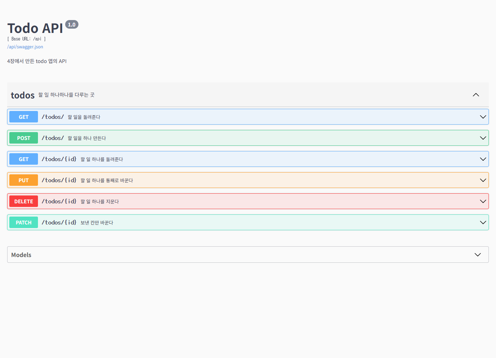
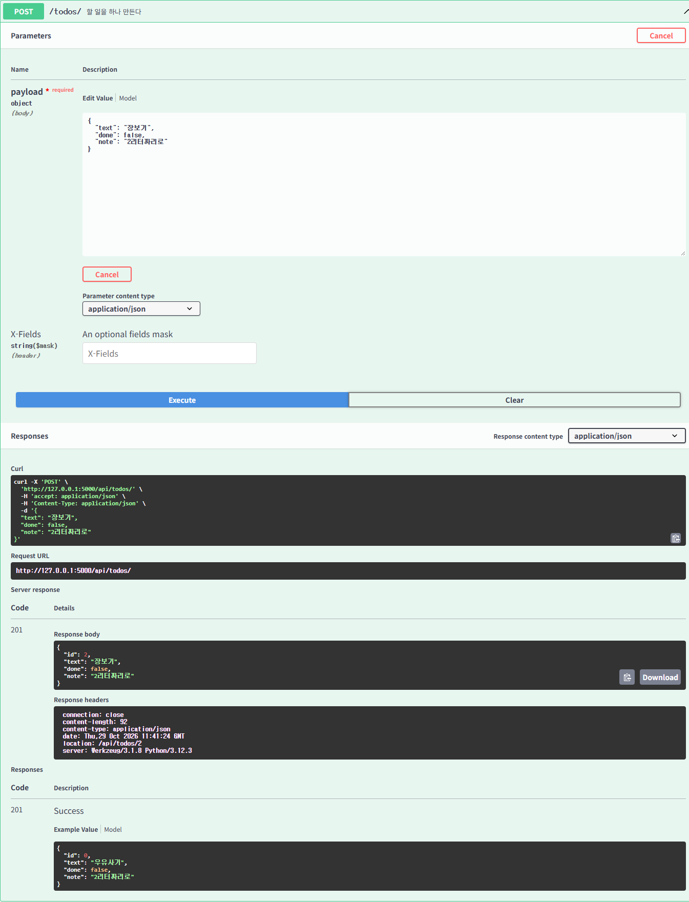
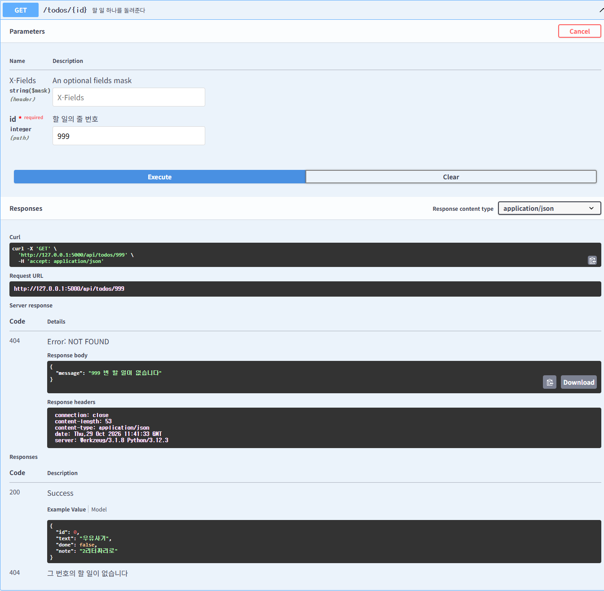

# HW4 : todo 앱에 API 더하기

## 더한 것
- 설명 칸(note)을 API 로도 주고받게 했습니다.
- GET /api/todos/?done=true 로 완료한 것만 골라 받게 했습니다.

## 실행하는 법

    pip install -r requirements.txt
    flask --debug run

화면 http://127.0.0.1:5000/
문서 http://127.0.0.1:5000/api/docs

테스트

    python -m unittest

## 화면
### 1. 주소 여섯 줄이 모두 보이는 문서

### 2. note 를 넣어 만들었더니 201 이 온 모습

### 3. 없는 번호를 불렀더니 404 가 온 모습

